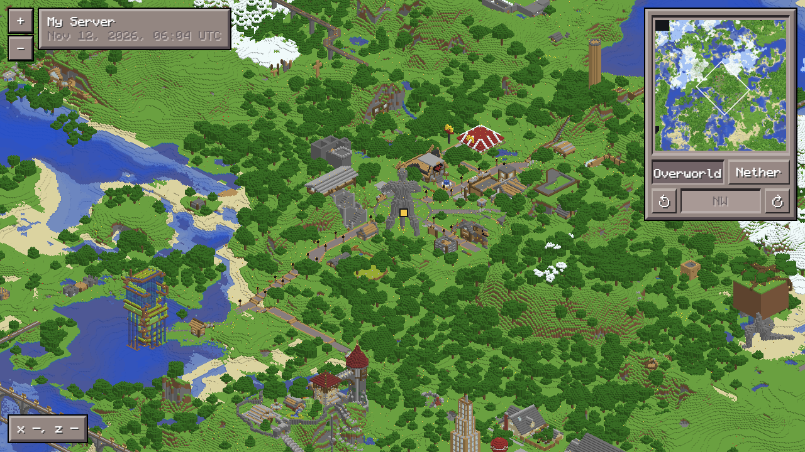

# beta-map

An isometric web map for Minecraft Beta worlds. Every block is drawn as a 4-pixel cube, from all four
directions, and cut into tiles.



- **Just Python.** One script, no packages to install (Python 3.8 or newer).
- **A plain static website.** The output is a folder of files. Host it anywhere, including GitHub Pages for free.
- **Read-only.** It only reads the world and never changes it.
- **Optional live player dots** if your server writes a small `players.json` (see below).

## What worlds it reads

Beta worlds in the **McRegion** format: Beta 1.3 to Beta 1.8, where the world folder has `region/r.X.Z.mcr` files.

## Drawing a map

1. Get a copy of your world folder: the one with `level.dat` and `region/` in it. A backup is perfect; drawing a
   world the server is writing to works too, but can catch half-saved chunks.
2. Run:

   ```
   python beta_map.py path/to/world site --title "My Server"
   ```

   (On Windows, `py` instead of `python` if `python` isn't found.)
3. `site` is now the whole website. To look at it on your own computer:

   ```
   python -m http.server 8000 --directory site
   ```

   then open http://localhost:8000. Opening `index.html` straight from the folder doesn't work, because browsers
   block a page on your disk from loading its own map files.

A first run takes a while: a world with 67 region files (each covers 512 x 512 blocks) took 1.5 minutes on a
12-core PC. The finished region pictures are kept in `site-cache`, so the next run only redraws the regions that
changed (the same world again: under 30 seconds).

### Options

| Option | What it does |
| --- | --- |
| `--title "Name"` | The name at the top left of the page |
| `--places places.txt` | Named places on the map, one per line: `overworld 120 -340 My Castle` (or `nether`); `#` starts a comment |
| `--spawn X,Z` | Where the spawn marker goes and where the map opens (default: the world's spawn point) |
| `--live URL` | Live player dots (see below) |
| `--no-player-count` | Hide the "Visitors" counter (bottom right: how many players have ever joined the server, counted from the world's `players` folder when the map is drawn) |
| `--every HOURS` | If you redraw the map on a schedule (cron, Task Scheduler), how many hours apart (1, 2, 3, 4, 6, 8, 12 or 24). The page then shows "Next update 6:30 PM (in 2h 5m)" in each viewer's own time zone. It's worked out from the clock, so keep it the same as your schedule |
| `--at HH:MM` | With `--every`: the time of one of the redraws, in your computer's own time like cron (default `00:00`). Example: cron `30 */6 * * *` is `--every 6 --at 00:30` |
| `--cache DIR` | Where the region pictures are kept between runs (default: the output folder's name plus `-cache`) |
| `--jobs N` | How many processes draw at once (default: your CPU cores minus one) |

## Putting it online with GitHub Pages

1. Make a new GitHub repository for the website.
2. Copy everything in your output folder into it (including the hidden `.nojekyll` file), commit and push.
3. In the repository's Settings > Pages, pick "Deploy from a branch", your main branch, and `/ (root)`.

To update the map, draw it again into the same folder and push again. Each map's tiles are in a folder named after
when the world was saved, and older ones are deleted, so browsers never show old cached tiles. If the repository
grows too big over time, push the site as a fresh single commit (`git checkout --orphan`) and force-push it.

## Live player dots (optional)

The page can show where players are with their name and skin face. It reads a small JSON
file every 2 seconds:

```json
{"time": 1700000000, "players": [{"name": "Steve", "x": 12.5, "y": 70.0, "z": -40.2, "world": "overworld"}]}
```

`time` is in Unix seconds; when it's over 30 seconds old the page says the server is offline. `world` is
`overworld` or `nether`. Something on your server has to write that file and serve it over HTTPS with an
`Access-Control-Allow-Origin: *` header. Then pass its URL with `--live https://example.com/players.json`.

- **Betrock++:** `extras/livemap.lua` writes it (needs the bpa_lua addon; instructions are at the top of the file).
- **Other servers** (Poseidon, Bukkit and so on) need a small plugin that writes the same file. Pull requests welcome.

Optionally, a `profiles.json` next to `players.json` gives players a skin face and a colour:
`{"Steve": {"skin": "https://textures.minecraft.net/texture/...", "colour": "#ff8800"}}`.

## How it works

- **Reading:** the script reads each region file's chunks itself (a small NBT reader is built in) and finds every
  block that can be seen: one with a face open to the air or to something see-through.
- **Drawing:** each visible block becomes a 4x4 pixel cube: a lighter top and two darker sides. Regions are drawn
  back to front so nearer blocks cover the ones behind. Water and glass are see-through, torches are glowing pixels
  in their own layer, and flowers, rails, fences and signs are little shapes.
- **Four directions:** the world is turned a quarter turn and drawn again, four times, for the turn buttons.
- **Tiles:** the pictures are cut into 512 x 512 squares, with smaller copies for zooming out. The page (built on
  [Leaflet](https://leafletjs.com/)) only loads the squares you're looking at.
- **Heights:** a hidden layer stores each column's height, so coordinates under the cursor, place markers and player
  dots sit exactly on the 3D picture.
- **Minimap:** a top-down picture, one pixel per block.

## Credits and licences

- beta-map: MIT licence (see `LICENSE`).
- [Monocraft](https://github.com/IdreesInc/Monocraft) font: SIL Open Font License, `web/Monocraft-OFL.txt`.
- [Leaflet](https://leafletjs.com/) 1.9.4: BSD 2-Clause, `web/Leaflet-LICENSE.txt`.

Minecraft is a trademark of Mojang; this project isn't affiliated with Mojang or Microsoft.
