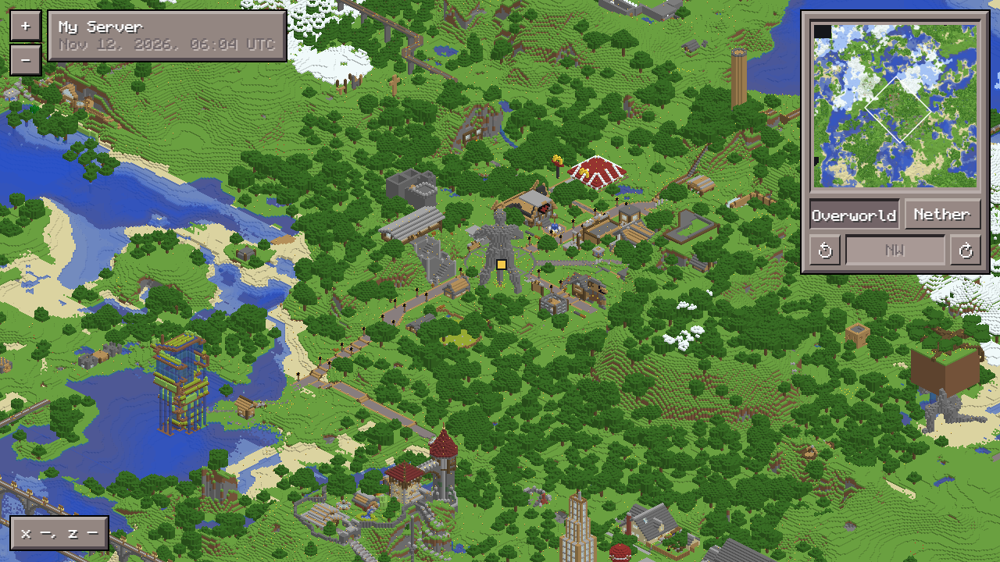

# beta-map

An isometric web map for Minecraft Beta worlds. Every block is drawn as a 4-pixel cube, from all four
directions, and cut into tiles.



- **Just Python**, no packages to install (Python 3.8 or newer), **plus an optional fast drawer in C** (one file,
  built with one command) that's many times faster, needs little memory and redraws only what changed. It runs
  on small machines: a Raspberry Pi, an old laptop, even a Wii running Linux.
- **A plain static website.** The output is a folder of files. Host it anywhere, including GitHub Pages for free.
- **Read-only.** It only reads the world and never changes it.
- **Optional live players** if your server writes a small `players.json` (see below): dots with faces, and a
  Players panel listing everyone who has ever joined, with search and a card for each player (play time, first and
  last time online, blocks mined, placed and walked). Click someone online and the view follows them.

## What worlds it reads

Beta worlds in the **McRegion** format: Beta 1.3 to Beta 1.8, where the world folder has `region/r.X.Z.mcr` files.

## Drawing a map

1. Get a copy of your world folder: the one with `level.dat` and `region/` in it. A backup is perfect; drawing a
   world the server is writing to works too, but can catch half-saved chunks.
2. Run:

   ```
   python beta_map.py path/to/world site --title "My Server"
   ```

   (On Windows, `py` instead of `python` if `python` isn't found.)
3. `site` is now the whole website. To look at it on your own computer:

   ```
   python -m http.server 8000 --directory site
   ```

   then open http://localhost:8000. Opening `index.html` straight from the folder doesn't work, because browsers
   block a page on your disk from loading its own map files.

In Python, a first run takes a while: a world with 67 region files (each covers 512 x 512 blocks) took 1.5
minutes on a 12-core PC. The finished region pictures are kept in `site-cache`, so the next run only redraws the
regions that changed (the same world again: under 30 seconds). For anything faster, or a small machine, build the
fast drawer:

### The fast drawer (recommended)

`beta-map-draw.c` does all the drawing in C. Build it once, next to `beta_map.py`, and `beta_map.py` uses it on its
own from then on (same command, same website, the same pixels):

```
cc -O2 -o beta-map-draw beta-map-draw.c -lz -lm
```

It needs a C compiler and zlib, which most Linux systems have (Debian, Ubuntu, Raspberry Pi OS:
`sudo apt install gcc zlib1g-dev`; macOS: `xcode-select --install`). On Windows, use WSL, or just keep the Python
drawing.

- **Fast:** a world of 67 region files (246 MB) draws in 34 seconds on one core of a PC, against 1.5 minutes on
  12 cores in Python, and in 14 seconds with `--views 1`. A slow machine takes longer in proportion (a 700 MHz
  single-core board: roughly 10 to 15 minutes for that first draw), but after that only changes are redrawn.
- **Little memory:** about 35 MB, however big the world (Python needs 120 MB or more per process).
- **Only what changed:** it keeps the finished tiles between runs, checks which region files changed (by size and
  time, then by contents), redraws only those, and rebuilds only the tiles they touch. Nothing changed: under a
  second. One region changed: a couple of seconds on a PC.
- **For very slow machines:** `--views 1` draws the world from one direction instead of four (a quarter of the
  work and of the disk space); the page then has no turn buttons.

It never changes the world, and a run that fails leaves the website as it was.

### Options

| Option | What it does |
| --- | --- |
| `--title "Name"` | The name at the top left of the page |
| `--places places.txt` | Named places on the map, one per line: `overworld 120 -340 My Castle` (or `nether`); `#` starts a comment |
| `--spawn X,Z` | Where the spawn marker goes and where the map opens (default: the world's spawn point) |
| `--live URL` | Live player dots (see below) |
| `--no-player-count` | Hide the "Visitors" counter (bottom right: how many players have ever joined the server, counted from the world's `players` folder when the map is drawn) |
| `--every HOURS` | If you redraw the map on a schedule (cron, Task Scheduler), how many hours apart (1, 2, 3, 4, 6, 8, 12 or 24). The page then shows "Next update 6:30 PM (in 2h 5m)" in each viewer's own time zone. It's worked out from the clock, so keep it the same as your schedule |
| `--at HH:MM` | With `--every`: the time of one of the redraws, in your computer's own time like cron (default `00:00`). Example: cron `30 */6 * * *` is `--every 6 --at 00:30` |
| `--cache DIR` | Where the region pictures are kept between runs (default: the output folder's name plus `-cache`) |
| `--jobs N` | Python drawing: how many processes draw at once (default: your CPU cores minus one) |
| `--views N` | Fast drawer: how many of the four directions to draw, 1 to 4 (default 4). 1 is a quarter of the work, and the page has no turn buttons |
| `--png-level N` | Fast drawer: how hard to compress the tiles, 1 (fastest, the default) to 9 (smallest files, slower) |
| `--drawer PATH` | Fast drawer: use this one (default: `beta-map-draw` next to `beta_map.py`, if it's been built) |
| `--no-drawer` | Draw in Python even if the fast drawer is built |

### Your own changes to the page

Don't edit `index.html`: every draw copies a fresh one into the site, and updating beta-map replaces it. Put your
changes in `custom.css` and `custom.js` in the site folder instead (next to `index.html`). The page loads them if
they're there, and beta-map never writes or replaces them, so they survive every redraw and every update. CSS can
restyle anything (colours, sizes, hiding a panel); `custom.js` runs after the page is set up, for anything else.

## Putting it online with GitHub Pages

1. Make a new GitHub repository for the website.
2. Copy everything in your output folder into it (including the hidden `.nojekyll` file), commit and push.
3. In the repository's Settings > Pages, pick "Deploy from a branch", your main branch, and `/ (root)`.

To update the map, draw it again into the same folder and push again. Each map's tiles are in a folder named after
when the world was saved, and older ones are deleted, so browsers never show old cached tiles. If the repository
grows too big over time, push the site as a fresh single commit (`git checkout --orphan`) and force-push it.

## Live player dots (optional)

The page can show where players are with their name and skin face. It reads a small JSON
file every 2 seconds:

```json
{"time": 1700000000, "players": [{"name": "Steve", "x": 12.5, "y": 70.0, "z": -40.2, "world": "overworld"}]}
```

`time` is in Unix seconds; when it's over 30 seconds old the page says the server is offline. `world` is
`overworld` or `nether`. Each player can also have `joined` (Unix seconds, for "Online for"), and `mined`,
`placed` and `walked` (blocks, lifetime totals). Something on your server has to write that file and serve it over
HTTPS with an `Access-Control-Allow-Origin: *` header. Then pass its URL with `--live https://example.com/players.json`.

**The Players panel** (bottom left; the "N online" line and the Visitors counter open it too) lists everyone who
has ever joined: who's online first, then everyone else by play time. Clicking a name shows their card, and clicking
someone online follows them; a link ending in `#follow=Name` opens the map following that player. The list comes
from two places:

- the world's `players` folder, read when the map is drawn (only with `--live`, and not with `--no-player-count`),
  so players from before you set up live players are listed too, just without stats;
- an optional `playtime.json` next to `players.json`, read every minute:
  `{"players": [{"name": "Steve", "first": "2026-01-02 15:04", "last": "2026-03-04 18:30", "secs": 7200, "mined": 950, "placed": 1200, "walked": 15000}]}`
  (`first` and `last` are UTC; every field but `name` is optional).

- **Betrock++:** `extras/livemap.lua` writes both files (needs the bpa_lua addon; instructions are at the top of the
  file). It keeps its own record in `livemap-players.tsv` in the server folder, so stats count from when you
  install it.
- **Other servers** (Poseidon, Bukkit and so on) need a small plugin that writes the same files. Pull requests welcome.

Optionally, a `profiles.json` next to `players.json` gives players a skin face and a colour:
`{"Steve": {"skin": "https://textures.minecraft.net/texture/...", "colour": "#ff8800"}}`.

## How it works

- **Reading:** the script reads each region file's chunks itself (a small NBT reader is built in) and finds every
  block that can be seen: one with a face open to the air or to something see-through.
- **Drawing:** each visible block becomes a 4x4 pixel cube: a lighter top and two darker sides. Regions are drawn
  back to front so nearer blocks cover the ones behind. Water and glass are see-through, torches are glowing pixels
  in their own layer, and flowers, rails, fences and signs are little shapes.
- **Four directions:** the world is turned a quarter turn and drawn again, four times, for the turn buttons.
- **Tiles:** the pictures are cut into 512 x 512 squares, with smaller copies for zooming out. The page (built on
  [Leaflet](https://leafletjs.com/)) only loads the squares you're looking at.
- **Heights:** a hidden layer stores each column's height, so coordinates under the cursor, place markers and player
  dots sit exactly on the 3D picture.
- **Minimap:** a top-down picture, one pixel per block.
- **The fast drawer** reads each changed region file once (32 chunks at a time; a column's picture depends on the
  ground up to 12 blocks around it, so three rows of chunks are enough), keeps only the blocks each column can
  show, and draws the 2048 px wide picture of a region in 512 px strips that line up with the tiles: every pixel
  column comes from just one diagonal of blocks. Each region's drawing is kept cut into tile pieces in the cache, so
  a tile is rebuilt from its pieces when one of the regions under it changes. The tiles stay in `site/tiles/c`
  between runs; each address ends in `?v=` and the draw's id, so browsers never show an old one.

## Credits and licences

- beta-map: MIT licence (see `LICENSE`).
- [Monocraft](https://github.com/IdreesInc/Monocraft) font: SIL Open Font License, `web/Monocraft-OFL.txt`.
- [Leaflet](https://leafletjs.com/) 1.9.4: BSD 2-Clause, `web/Leaflet-LICENSE.txt`.

Minecraft is a trademark of Mojang; this project isn't affiliated with Mojang or Microsoft.
